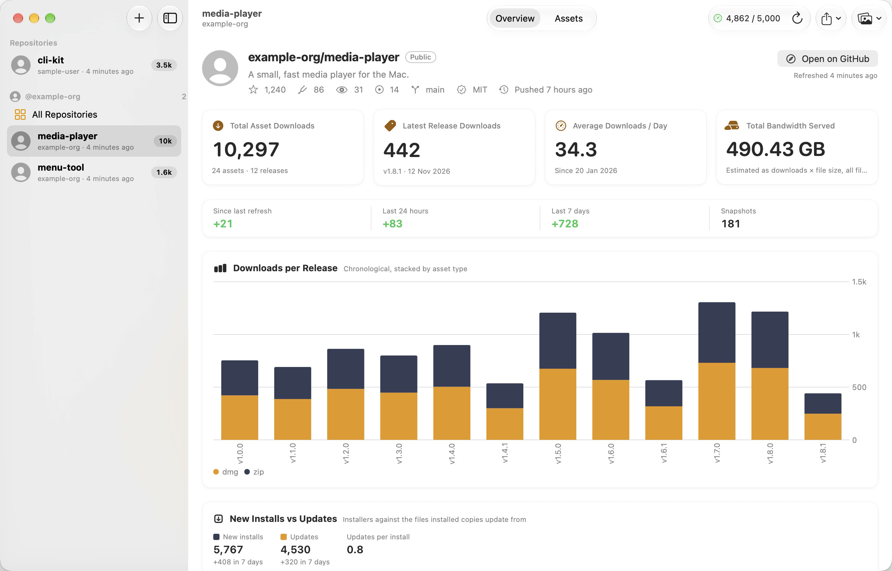

  

<h1 align="center">ElBee Stats</h1>

  <strong>Your GitHub release downloads, tracked over time, in a native Mac app.</strong>

  <picture><source media="(prefers-color-scheme: dark)" srcset="assets/brand/elbeehq-hive-on-dark.svg"></picture>&nbsp;<picture><source media="(prefers-color-scheme: dark)" srcset="assets/brand/elbeehq-wordmark-on-dark.svg"></picture>

  
  
  
  
  
  

  <picture>
    <source media="(prefers-color-scheme: dark)" srcset="assets/screenshot-dark.jpg">
    
  </picture>

GitHub keeps only a running total for each release file. ElBee Stats saves a snapshot every time it refreshes, so
you see trends, release adoption, new installs against updates, stars and traffic, for single repositories or whole
accounts.

## Why ElBee Stats

- **The history GitHub doesn't keep:** downloads per day, the change over 24 hours and 7 days, and dashed lines
  marking each release.
- **Real downloads, not update checks.** Update feeds and checksum files stay out of the totals and are shown
  separately.
- **Release adoption:** how quickly people move to a new release, new installs against updates, and each release's
  first 30 days laid over the others.
- **Repositories or whole accounts:** follow a user or organisation and every repository in it is tracked, new ones
  included. A menu bar summary and a desktop widget keep it in view.
- **Private by design.** No account, analytics, ads or tracking. It connects only to GitHub, and an optional token
  stays in your Mac's Keychain.
- **Updates itself,** from this page, checked against ElBee Stats' signing key. Your repositories and history are kept.

## Download

  

1. Download the disk image from the [latest release](https://github.com/ElBeeHQ/ElBeeStats/releases/latest) or
   [elbeehq.com/stats](https://elbeehq.com/stats/), open it and drag **ElBee Stats** onto **Applications**.
2. Allow it once. ElBee Stats isn't notarised by Apple, so the first time you open it macOS may say it can't verify
   it: open **System Settings › Privacy & Security**, scroll to the message about ElBee Stats and click **Open Anyway**.
3. Press **⌘N** and enter a repository (`owner/repo` or its GitHub link), or a user or organisation name.

Needs macOS 14 or later on Apple silicon or Intel. A GitHub token is optional: it raises GitHub's limit from 60 to
5,000 requests an hour, adds your private repositories, and shows clone and view traffic for repositories you own.

## Links

[What's New](CHANGELOG.md) · [Help](https://elbeehq.com/support) · [Report a problem](https://github.com/ElBeeHQ/ElBeeStats/issues) ·
[Privacy](https://elbeehq.com/privacy) · [Legal & Terms](https://elbeehq.com/legal) · [elbeehq.com](https://elbeehq.com)

ElBeeHQ is not affiliated with, endorsed by or sponsored by GitHub or Apple. GitHub is a trademark of GitHub,
Inc. Mac and macOS are trademarks of Apple Inc. The screenshot shows made-up repositories. Other names belong to their
owners and are used only to describe compatibility.

© 2026 ElBeeHQ. Free for personal, non-commercial use; see [LICENSE](LICENSE). ElBee Stats includes Sparkle
(MIT) for its updates.
